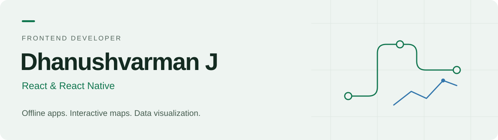

<picture>
  <source media="(prefers-color-scheme: dark)" srcset="assets/banner-dark.svg">
  <source media="(prefers-color-scheme: light)" srcset="assets/banner-light.svg">
  
</picture>

  <a href="https://www.linkedin.com/in/dhanushvarman-j-51b827180/">LinkedIn</a> &nbsp;·&nbsp;
  <a href="mailto:dhanushvarmanj@gmail.com">Email</a> &nbsp;·&nbsp;
  <a href="assets/Dhanush_Resume.pdf">Resume</a> &nbsp;·&nbsp;
  Chennai, India

I build **React and React Native applications** that help people collect data in the field, understand complex information, and manage everyday operations.

With **3+ years of frontend experience**, my work spans energy auditing, traffic monitoring, research visualization, and routing simulations. I work across implementation, client discussions, feature planning, and product walkthroughs.

**My focus:** offline capabilities and data synchronization · interactive maps and charts · reliable web and mobile experiences

[Selected work](#selected-professional-work) · [Technologies](#technologies-i-work-with) · [Contact](#lets-connect)

## Selected professional work

Professional projects are presented as experience summaries, without source code or links to internal systems.

### IEAC · Energy audit platform
**Team Lead & Frontend Developer**

An energy audit platform built for auditors working across web and mobile.

- Led project delivery, client communication, and feature planning.
- Built the React Native audit app with offline data collection and synchronization.
- Supported web and mobile releases, auditor training, and product walkthroughs.

### GCTP · Chennai traffic monitoring
**Project Owner & Frontend Lead**

Web and mobile applications supporting traffic monitoring and incident reporting across Chennai.

- Developed **Leaflet** map interfaces for traffic and location visualization.
- Built mobile reporting workflows supporting field officers and control-room teams.
- Worked directly with officers to understand operational needs and demonstrated the application at the Commissioner's office.

### IIT Madras · Waste collection routing simulation
**Project Associate · October 2025 – March 2026**

An interactive web platform for exploring vehicle routing scenarios for city-wide solid waste collection.

- Developed and deployed the simulation interface under the guidance of **Dr. Nikhil Bugalia**.
- Built workflows to upload datasets, run routing simulations, and visualize optimized vehicle paths.
- Connected complex routing scenarios to an interface users could explore and understand.

### SGRI · Research data visualization
**Frontend Developer · August 2023 – February 2024**

A data exploration interface developed for Saint Gobain Research India.

- Built Excel upload workflows for structured data handling.
- Integrated **Plotly.js** for interactive, customizable charts and data exploration.

## Technologies I work with

| Area | Technologies |
| :--- | :--- |
| Web & mobile | React, React Native, TypeScript, JavaScript, HTML, CSS |
| State & APIs | Redux, Redux-Saga, RTK Query, REST APIs, Axios |
| Offline & local data | Service Workers, IndexedDB, SQLite, Drizzle ORM |
| Maps & visualization | Leaflet, Google Maps, Plotly.js, React Flow |
| UI & tooling | Ant Design, Tailwind CSS, Bootstrap, Formik, Git |
| Reporting & diagnostics | Node.js, Puppeteer, rrweb, html2canvas |

## Engineering interests

- **Offline workflows:** keeping field applications useful with limited connectivity and synchronizing data when a connection returns.
- **Visual interfaces:** making spatial data, analytics, and connected systems easier to navigate.
- **Application diagnostics:** combining session replay, screenshots, and API context to investigate errors.
- **Document automation:** generating PDFs with dynamic content, pagination, and consistent layouts using Puppeteer.

## Beyond implementation

- Frontend Developer at **Mandark Technologies Private Limited**, since April 2023.
- Presented the IEAC audit tool at **IIT Madras and IIT Gandhinagar**, gathering feedback from auditors and industry professionals.
- Conducted knowledge-sharing sessions on **Puppeteer document services and Clean Code**.
- B.Tech in Civil Engineering from **SSN College of Engineering**.

## Let's connect

Interested in my work or want to discuss frontend development?

[LinkedIn](https://www.linkedin.com/in/dhanushvarman-j-51b827180/) · [dhanushvarmanj@gmail.com](mailto:dhanushvarmanj@gmail.com) · [View my resume](assets/Dhanush_Resume.pdf)
